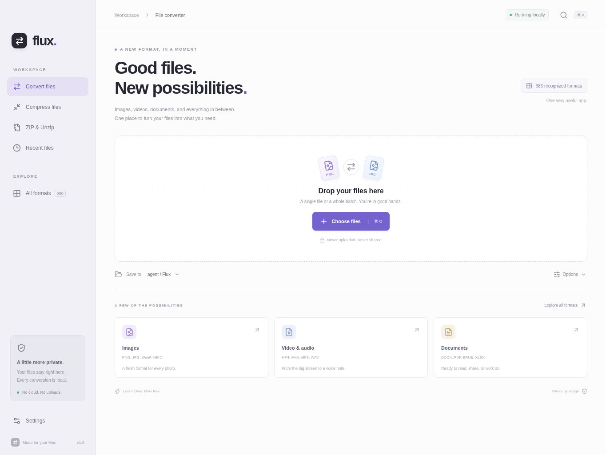
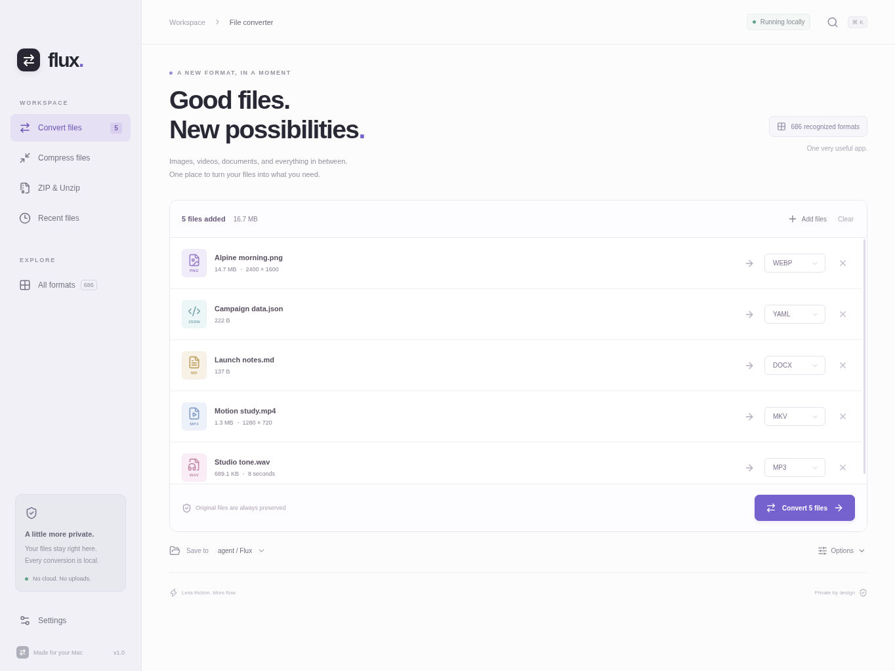
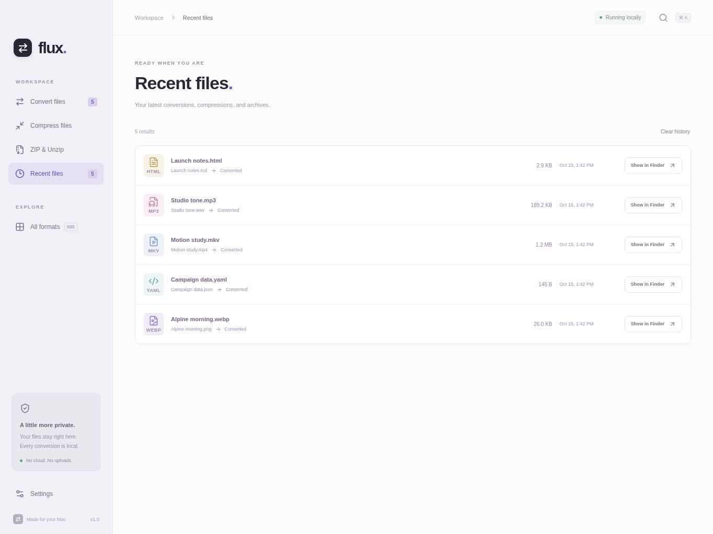
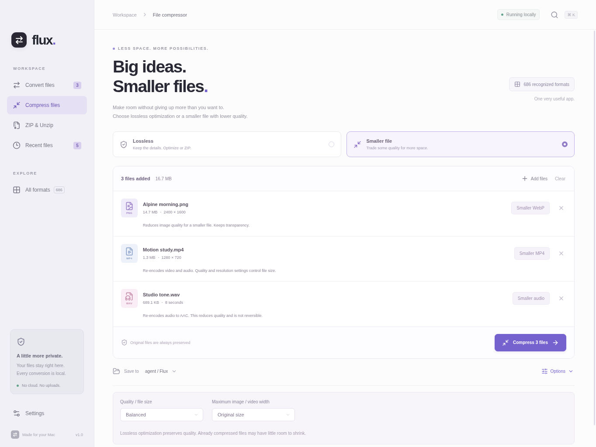
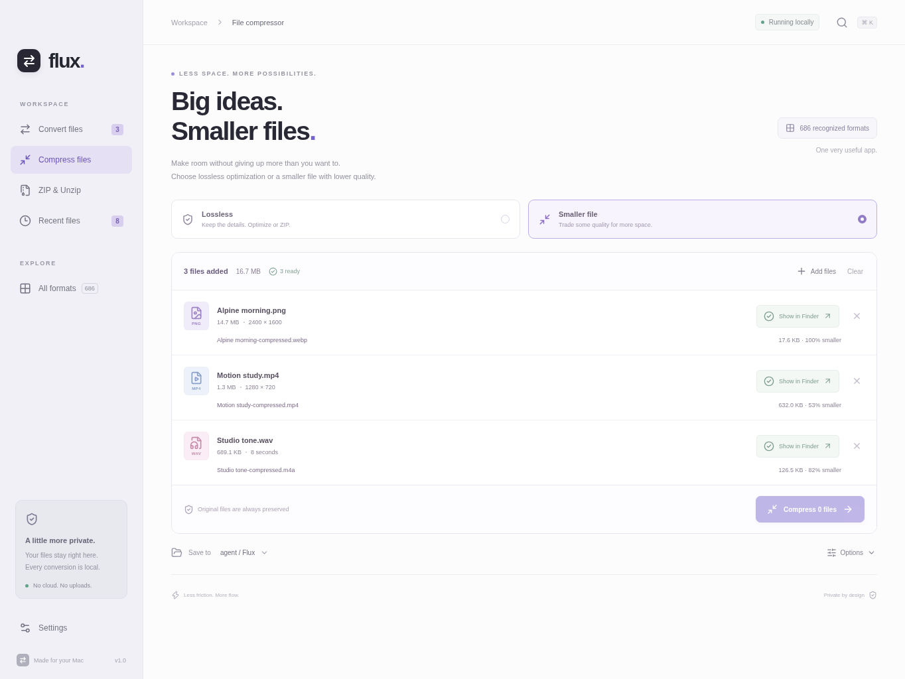
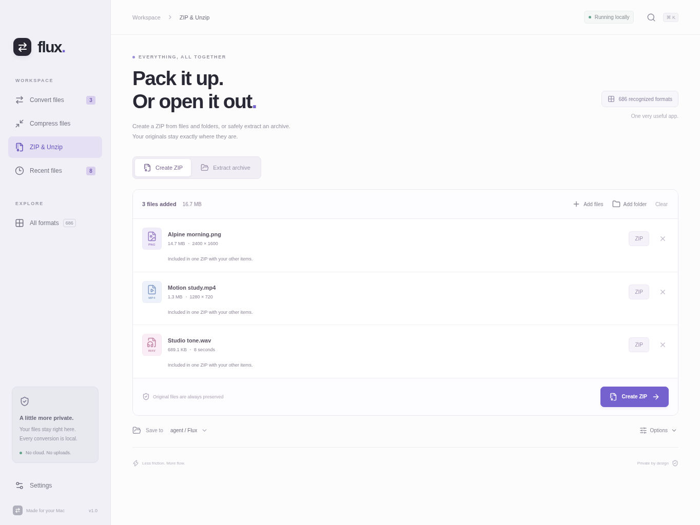
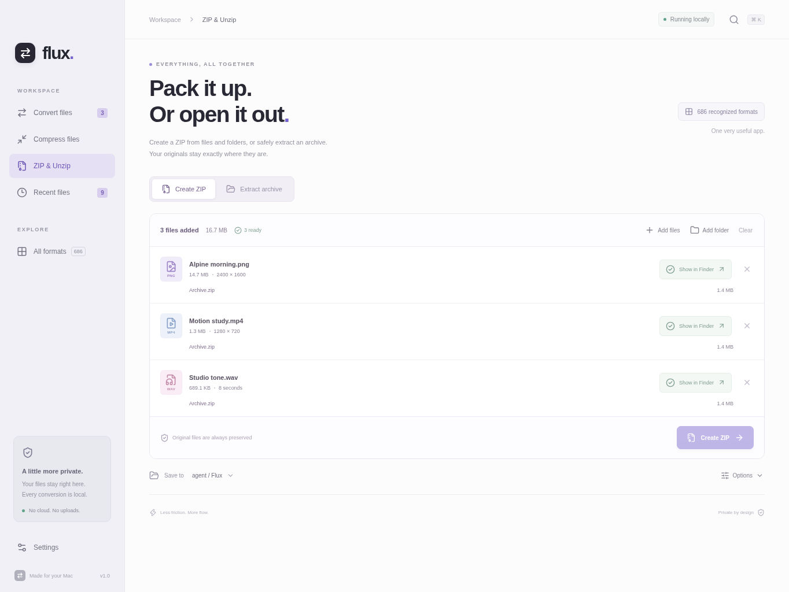
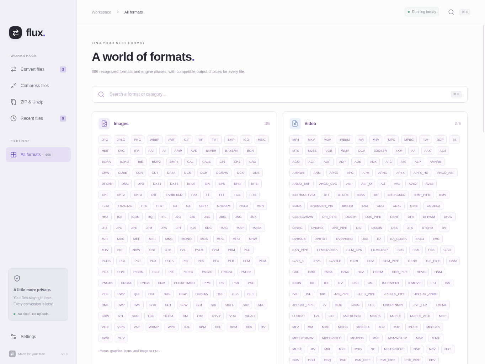
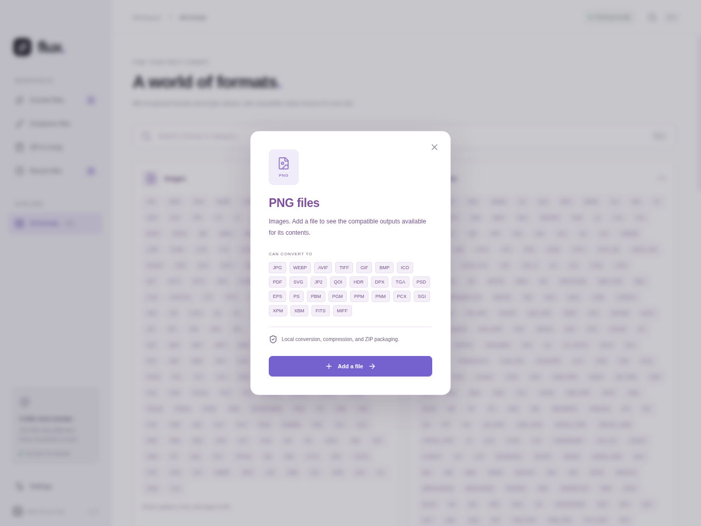
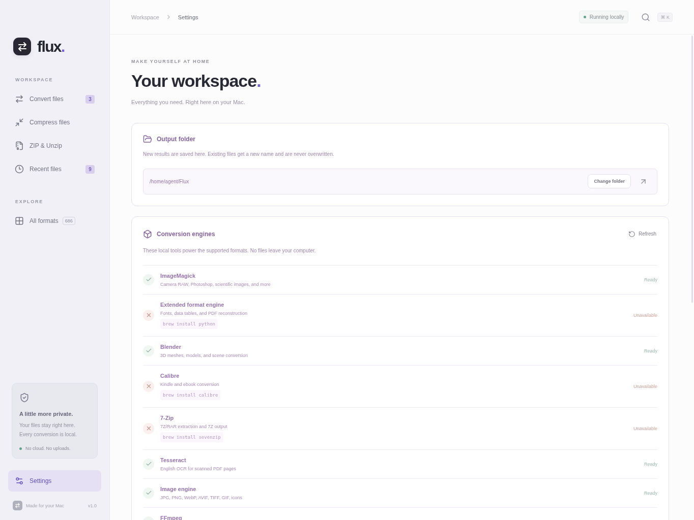

# Flux showcase

Real, unretouched captures of the Flux Electron app built from commit `7fe285d97f45e9ca102cd7e744b8392544cf30e4`. Captured on a cloud Linux desktop on 15 October 2026 at 1364 × 1024. The application code and interface were not changed for these images. All input files were synthetic; no personal files or production accounts were used.

## Start here

The full workspace, local processing message, file picker, output destination and format families.

## Mixed-format conversion

A real queue containing an image, structured data, a document, video and audio, with per-file output choices.

Five completed conversions: PNG → WebP, JSON → YAML, Markdown → HTML, MP4 → MKV and WAV → MP3. The document target was changed from the initially queued DOCX to HTML because the cloud Pandoc installation lacked its DOCX template data.

## Compression

Lossless and smaller-file modes, quality settings and maximum image/video width.

Actual image, video and audio compression results. The intentionally uncompressed synthetic image is highly compressible; its displayed “100% smaller” is the app's rounded percentage, not a zero-byte result or a general savings claim. The image output was 18,042 bytes, video 647,170 bytes and audio 129,541 bytes.

## ZIP packaging

Files and folders can be grouped into one archive; the extraction mode is available beside Create ZIP.

The three synthetic media inputs were successfully packaged into a single 1,482,438-byte ZIP. Archive extraction was not exercised during this capture session.

## Format discovery

The searchable, engine-discovered catalog. Its count includes aliases and is not a promise that every file with a listed extension will decode.

A real PNG format-detail dialog with compatible output choices.

## Workspace settings

Output-folder controls and the engine availability reported by this capture environment.

## Capture boundaries

- These are the Electron desktop interface running on Linux, not native macOS or iPhone screenshots. Existing Mac-oriented interface labels are preserved as shipped.
- The overview and key workflows show the complete application viewport. Catalog and settings pages are longer than one screen and show their initial viewport.
- Real conversions used the app's installed engines. No queue entries, completed states, savings figures or screenshots were mocked.
- Some optional engines were unavailable on this Linux computer, including the extended Python engine, Calibre and 7-Zip. The macOS PDF helper and LibreOffice were also absent. The screenshots do not claim those conversion paths were tested.
- No hosted CI, release build or deployment was used. Only documentation and screenshot assets are included in this gallery.
